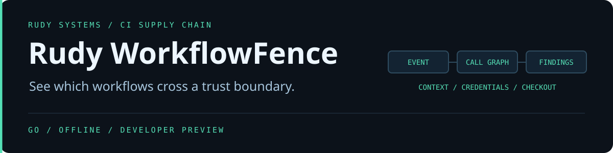

**A workflow can look harmless until you see who calls it.** WorkflowFence is an offline GitHub Actions policy checker. It follows local reusable workflow calls, shows the shortest path from an externally influenced event to a flagged job, and can block a build at a chosen severity.

## Try it

Download a [native preview](https://github.com/r4venrudy/rudy-workflowfence/releases), verify the archive against SHA256SUMS.txt, and extract it. Run against your local repository root. Add .exe to the command on Windows.

~~~sh
bin/workflowfence --root . --format text
bin/workflowfence --root . --format sarif --fail-on never > workflowfence.sarif
bin/workflowfence --root examples/safe --format json
bin/workflowfence --root examples/review --format json --fail-on never
~~~

The safe fixture uses a read-only token, a pinned checkout without persisted credentials, and a quoted environment variable for event text. The review fixture is inert sample data. Its caller reaches a reusable job with several unsafe settings. WorkflowFence reports the source lines and the call path without running either workflow.

## Rules

| Rule | Severity | Signal |
| --- | --- | --- |
| WF001 | High | Selected externally influenced GitHub context is interpolated directly into a run script |
| WF002 | Medium | Remote action or workflow uses a mutable reference, or a container action lacks an image digest |
| WF003 | High | Broad write-all declaration or declared write scopes on a privileged external path |
| WF004 | High | Checkout on a privileged external path selects a known externally influenced revision or repository |
| WF005 | Medium | A job inherits the repository's token defaults |
| WF006 | High | An external event reaches a job with an explicit self-hosted label |
| WF007 | Medium | Checkout persists credentials on an external path or in a write-enabled job |
| WF008 | High | A local reusable workflow is missing or lacks a workflow_call trigger |
| WF009 | Medium | A dependency reference cannot be classified |
| WF010 | High | Local reusable workflow call cycle |
| WF011 | High | A call on an external path inherits secrets |
| WF012 | High | A permission declaration does not use the expected static form |

Exit 0 means the report falls below the configured gate. Exit 1 means at least one finding met it. Exit 2 indicates invalid input, configuration, or an output error. The default is high. Use medium to gate both levels or never to emit a report without gating. JSON schema version 1 includes dependencies and findings. SARIF 2.1.0 includes the rules and file locations.

## Build and test

Use Go 1.25 or newer. Go 1.27.3 is pinned in CI. The YAML dependency is pinned in go.mod and go.sum. Python 3.10 or newer runs the independent CLI checks and packaging.

~~~sh
go mod download
go mod verify
go test ./...
go vet ./...
go build -trimpath -o bin/workflowfence ./cmd/workflowfence
python tests/integration.py bin/workflowfence .
~~~

The analyzer reads local .github/workflows YAML files, with 128 directory entries, 256 KiB per workflow, and a 4 MiB aggregate input limit. It rejects duplicate keys, YAML aliases, and anchors. The graph covers job-level calls to local reusable workflows. Remote implementations, composite action bodies, repository settings, runner group membership, arbitrary shell and expression evaluation, and dynamic job conditions are outside the analysis. Token findings describe declared scopes. Caller restrictions, fork downgrades, organization policies, and environments may reduce effective access. The checker does not contact GitHub, resolve references, or execute workflows.

[GitHub Actions secure-use guidance](https://docs.github.com/en/actions/reference/security/secure-use) · [Workflow syntax](https://docs.github.com/en/actions/reference/workflows-and-actions/workflow-syntax)
